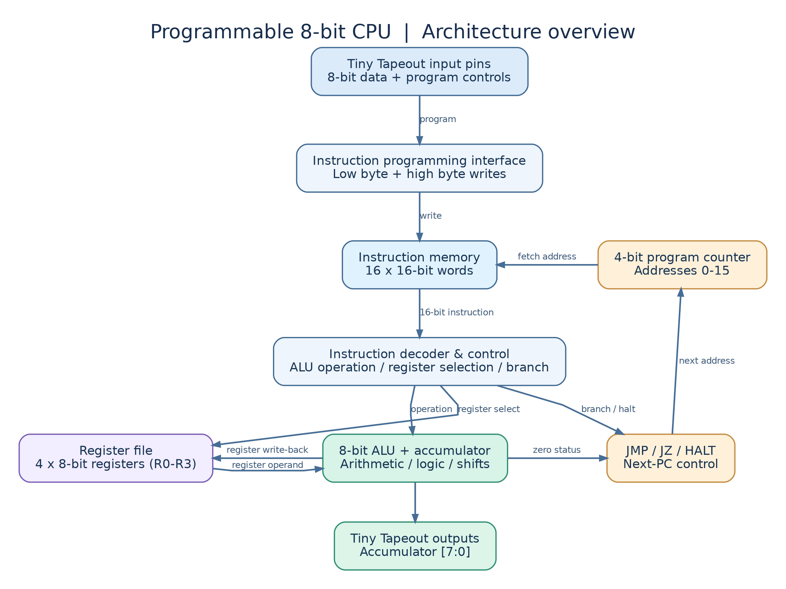
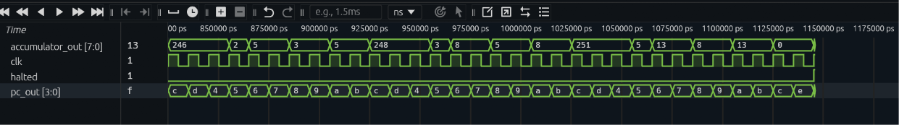
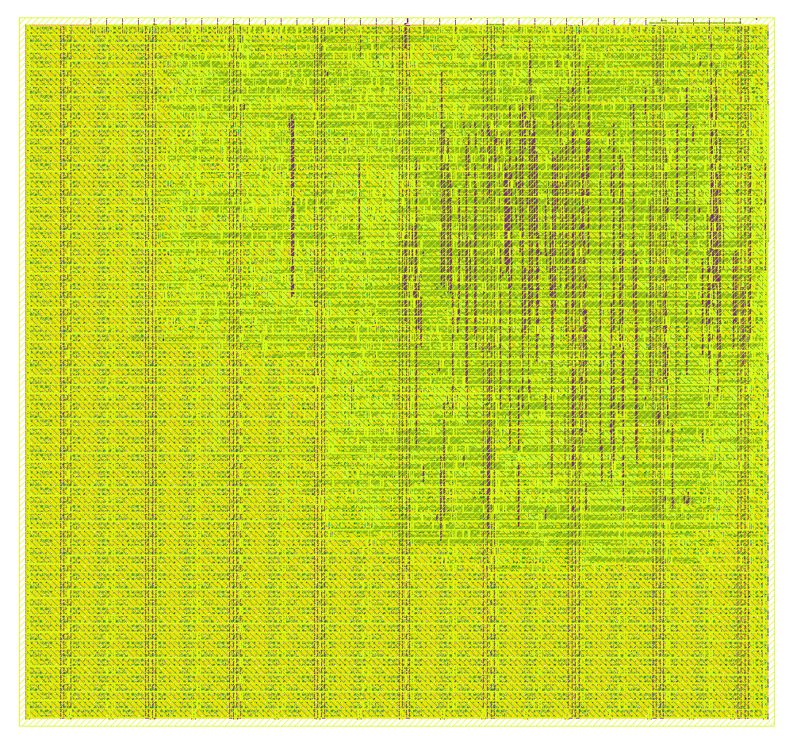

# Programmable 8-Bit CPU — Verilog ASIC Design

**A custom, programmable 8-bit processor built in Verilog and taken from RTL to a GF180MCU physical layout—complete with an assembler, reference emulator, self-checking tests and automated build workflows.**

[](https://github.com/YousefTamerEEE/tt-8-bit-cpu-tinytapeout/actions/workflows/cpu-v2-regression.yml)
[](https://github.com/YousefTamerEEE/tt-8-bit-cpu-tinytapeout/actions/workflows/gds.yaml)

**Author:** Yousef Tamer · **Hardware:** Verilog · **Toolchain:** Python, Icarus Verilog, GitHub Actions, LibreLane, Tiny Tapeout · **Process:** GF180MCU (180 nm)

> **Project status — November 2026:** Final CPU design merged into `main` and **submitted to the Vulkos UniChip Chipathon**. Tiny Tapeout GDS, precheck, gate-level simulation and documentation workflows have passed for the **GF180MCU 1×2-tile** implementation. **Competition selection, fabrication and testing on physical silicon are still pending.**

## Results at a glance

| Verification and implementation | Result |
| --- | --- |
| CPU instruction tests | **62 scenarios passed; 384 RTL/reference-model cycles matched** |
| Three example programs | **Counter, multiplication, Fibonacci**; 134 additional matched cycles in end-to-end differential runs |
| Assembler | **14 automated unit tests** |
| ASIC technology and area | **GlobalFoundries GF180MCU**, Tiny Tapeout **1×2 tile** |
| RTL-to-GDS flow | Synthesis, placement, clock-tree synthesis, routing, GDS generation **completed** |
| Final timing result | **+18.11 ns setup slack**, **+0.236 ns hold slack** (worst reported) |
| Physical checking | **0 final routing DRC errors**, **0 LVS errors**; some electrical constraints remain outstanding |
| Hardware demonstration | Successful **simulation**; silicon not manufactured or bench-tested yet |

## Highlights

| Feature | Implementation |
| --- | --- |
| Datapath | 8-bit accumulator-based CPU |
| Registers | Four 8-bit general-purpose registers (R0–R3) |
| Instruction word | 16 bits |
| Program storage | 16 × 16-bit programmable instruction memory |
| Program counter | 4 bits (addresses 0–15) |
| Instruction set | 15 assembler mnemonics: immediate, arithmetic, logic, register, branch, halt |
| Control flow | Unconditional `JMP` and zero-conditional `JZ` |
| Chip interface | Two-byte programming over Tiny Tapeout input pins; accumulator on eight output pins |
| Silicon target | GF180MCU, Tiny Tapeout 1×2 tile |
| Physical-design configuration | 60 ns clock-period target; 60% placement-density target (not a measured silicon operating frequency) |
| Verification | 14 assembler tests, 62 comprehensive CPU scenarios, Python/RTL differential comparison, three full demo programs |

## CPU architecture



*Architecture-level diagram; intended as a readable overview rather than a complete gate-level netlist.*

The CPU executes instructions sequentially after external programming. The ALU supports load, addition, subtraction, bitwise AND/OR/XOR and shifts. A zero flag derived from the accumulator controls `JZ`. A `HALT` instruction stops program-counter advancement. Unprogrammed instruction addresses behave as `HALT` until written.

**RTL sources:** [`src/`](src/) contains `cpu.v`, `processor.v`, `instruction_decoder.v`, `instruction_memory.v`, `program_counter.v`, `register_file.v`, and the Tiny Tapeout top-level wrapper.

## Demonstrated programs

Each program is assembled to 16-bit instructions, loaded into the **actual RTL CPU through the simulated programming pins**, executed in Icarus Verilog, and checked by a dedicated self-checking Verilog testbench.

| Program | What it demonstrates | Verified result | Files |
| --- | --- | --- | --- |
| Counter | Looping, branch-on-zero, register storage | Counts **0 → 5** and halts with accumulator **5**, PC **9** | [`demo_counter.asm`](demo_counter.asm) · [`test_counter.v`](test_counter.v) |
| Multiplication | **3 × 4** via repeated addition | Accumulator **12**, PC **15**, halted | [`demo_multiply.asm`](demo_multiply.asm) · [`test_multiply.v`](test_multiply.v) |
| Fibonacci | Register updates, loop, arithmetic and branching | **0, 1, 1, 2, 3, 5, 8, 13**; accumulator **13**, PC **15**, halted | [`demo_fibonacci.asm`](demo_fibonacci.asm) · [`test_fibonacci.v`](test_fibonacci.v) |

### Fibonacci execution waveform



*Waveform captured from the Icarus Verilog simulation using Surfer. The selected final state shows `accumulator_out = 13`, `halted = 1`, and `pc_out = 0xF`.*

### Final physical-design layout



*Actual KLayout render from the final GF180MCU physical-design run (1×2 tiles). This is a **layout visualization**, not a photograph of fabricated silicon. The intricate coloured regions show standard cells and routed metal layers.*


## Python assembler

[`assembler.py`](assembler.py) converts readable assembly into three useful outputs:

- **`.hex`** — 16 instruction words, 16 bits each (unused locations filled with `F000` = HALT).
- **`.lst`** — annotated source-to-machine-code listing.
- **`.csv`** — the per-clock pin values to write the low byte and high byte of each instruction through the external programming interface.

```bash
python3 assembler.py demo_counter.asm
python3 assembler.py demo_multiply.asm
python3 assembler.py demo_fibonacci.asm
```

Optional output prefix:

```bash
python3 assembler.py demo_fibonacci.asm -o build/fibonacci
```

The assembler resolves forward/backward labels, validates operands and register names, rejects invalid instructions, and enforces the 16-word program capacity. Its behavior is covered by **14 automated Python unit tests** in [`test_assembler.py`](test_assembler.py).

### Instruction set

The 16-bit instruction format is:

```text
15          12 11        10 9          8 7                    0
+-------------+------------+------------+----------------------+
| opcode (4)  | dest (2)   | source (2) | immediate / addr (8) |
+-------------+------------+------------+----------------------+
```

| Opcode (hex) | Assembly | Operation |
| --- | --- | --- |
| `0` | `LDI n` | Accumulator ← immediate `n` |
| `1` | `ADDI n` | Accumulator ← accumulator + `n` |
| `2` | `SUBI n` | Accumulator ← accumulator − `n` |
| `3` | `ANDI n` | Accumulator ← accumulator AND `n` |
| `4` | `ORI n` | Accumulator ← accumulator OR `n` |
| `5` | `XORI n` | Accumulator ← accumulator XOR `n` |
| `6` | `SHL` | Shift accumulator left by one |
| `7` | `SHR` | Shift accumulator right by one |
| `8` | `STR Rn` | Register `Rn` ← accumulator |
| `9` | `LDR Rn` | Accumulator ← register `Rn` |
| `A` | `JMP label` | Jump to address/label |
| `B` | `JZ label` | Jump if accumulator is zero |
| `D` | `ADDR Rn` | Accumulator ← accumulator + register `Rn` |
| `E` | `XORR Rn` | Accumulator ← accumulator XOR register `Rn` |
| `F` | `HALT` | Stop execution |

Arithmetic is 8-bit modular arithmetic (results wrap at 256). Opcode `C` is not currently implemented.

## Programming interface

Tiny Tapeout pins are used as follows:

| Signal | Purpose |
| --- | --- |
| `ui_in[7:0]` | Instruction byte supplied to the CPU |
| `uio_in[3:0]` | Instruction address (0–15) |
| `uio_in[4]` | Byte select: **0 = low**, **1 = high** |
| `uio_in[5]` | Programming write strobe |
| `uio_in[6]` | Programming-mode enable |
| `uo_out[7:0]` | 8-bit accumulator output |
| `clk`, `rst_n` | Clock and active-low reset |

For each instruction, drive the **low byte** first (`uio_in = 0x60 | address`) and pulse the clock; then drive the **high byte** (`uio_in = 0x70 | address`) and pulse the clock again. The second clock edge writes the full instruction. The assembler-generated CSV contains these pin patterns.

Reset clears instruction-valid flags, so **do not reset after loading the program** unless you intend to reprogram it. Set `uio_in[6] = 0` to leave programming mode and execute.

> Current I/O is intentionally minimal: the CPU **outputs its accumulator** but does not yet provide a general-purpose program-controlled GPIO instruction. Adding that capability is a potential future revision.

## Verification strategy and evidence

**Independent reference checking:** A Python CPU emulator serves as the expected-behaviour model. The Verilog RTL is executed in Icarus Verilog, and automated scripts compare the two on the same instructions.

- **62 passing CPU test scenarios and 384 matching cycles** in the comprehensive instruction suite (`test_instruction_suite.py`): arithmetic, shifts, register transfer, branches, boundaries and directed/random cases.
- **134 matching cycles** from differential checks across the counter, multiplication and Fibonacci programs (`test_differential.py`).
- **14 passing assembler unit tests**, plus self-checking RTL testbenches for each example program.
- GitHub Actions builds and tests the repository. The current CPU regression workflow is configured for pushes to `cpu-v2` and pull requests into `main`; the extended differential/instruction suites were also run separately on the final design.

**These figures describe simulation/verification, not measured performance of a manufactured chip.**

## Reproduce the verification

Requirements: Python 3 and Icarus Verilog (`iverilog` and `vvp`). Run from the repository root.

**1. Run the assembler's 14 unit tests**

```bash
python3 -m unittest -v test_assembler.py
```

**2. Generate the three programs**

```bash
python3 assembler.py demo_counter.asm
python3 assembler.py demo_multiply.asm
python3 assembler.py demo_fibonacci.asm
```

**3. Run the RTL simulations**

```bash
iverilog -g2012 -s test_counter -o counter_sim test_counter.v src/*.v && vvp counter_sim
iverilog -g2012 -s test_multiply -o multiply_sim test_multiply.v src/*.v && vvp multiply_sim
iverilog -g2012 -s test_fibonacci -o fibonacci_sim test_fibonacci.v src/*.v && vvp fibonacci_sim
```

The testbenches check program loading, intermediate behavior and final results. They generate `.vcd` waveforms for inspection in Surfer or GTKWave.

**4. Run the independent Python/RTL cross-checks**

```bash
python3 test_differential.py
python3 test_instruction_suite.py
```

**5. Continuous integration**

The [CPU V2 Automated Regression](https://github.com/YousefTamerEEE/tt-8-bit-cpu-tinytapeout/actions/workflows/cpu-v2-regression.yml) workflow currently runs on pushes to `cpu-v2` or pull requests into `main` and covers assembler tests plus the three demo simulations. Tiny Tapeout GDS, precheck, gate-level and documentation workflows are separate.

## ASIC implementation and engineering trade-offs

The CPU targets **GF180MCU (180 nm)** using LibreLane and the Tiny Tapeout digital ASIC flow. Starting from Verilog RTL, the design passed through synthesis, floorplanning, standard-cell placement, clock-tree synthesis, detailed routing and GDS generation.

### Challenges and solutions

1. **Fitting the design:** the original 1×1 implementation had placement/routability issues; using a **1×2 tile** provided sufficient physical space while preserving the CPU's architectural functionality.
2. **Meeting timing:** an aggressive **45 ns** goal caused negative slow-corner setup slack. Moving to a **60 ns layout clock-period target** and adjusting implementation settings led to positive setup and hold slack across the checked corners. `info.yaml` conservatively advertises **16 MHz**; this is a design target, **not silicon-measured performance**.
3. **Electrical repair trade-offs:** targeted standard-cell exclusions and post-global-route design repair reduced transition violations without changing the programmer-visible instruction set.

### Final physical-design results

Numbers below are from the **final development run's LibreLane metrics** (GF180MCU, 60 ns target, post-global-route repair enabled), not extrapolations from physical silicon.

| Check / measurement | Reported result |
| --- | ---: |
| Worst setup slack | **+18.11 ns** |
| Worst hold slack | **+0.236 ns** |
| Detailed-route DRC errors | **0** |
| LVS errors | **0** |
| Remaining maximum-transition violations | **171** |
| Remaining maximum-capacitance violations | **1** |

**Engineering limitation:** a passing GDS/precheck workflow is not the same as full electrical sign-off. The above max-transition and max-capacitance issues remain open. The layout has not yet been fabricated, so functionality on real silicon is unverified.

**Configuration:** [`src/config.json`](src/config.json) retains the implementation settings. `info.yaml` identifies the GF180MCU shuttle target and **1×2** tile size. The submitted code is on the `main` branch; earlier development branches are retained for historical comparison.

## Repository guide

```text
src/                       Verilog CPU, ALU, registers, memory, control, top-level
assembler.py                Python assembly-to-machine-code compiler
test_assembler.py           14 Python assembler unit tests
demo_counter.asm            Counter demonstration
demo_multiply.asm           Repeated-addition multiplication
demo_fibonacci.asm          Fibonacci demonstration
cpu_emulator.py             Python architecture reference model
test_differential.py         Differential RTL/Python comparison
test_instruction_suite.py    62-scenario CPU verification suite
test_counter.v              Counter self-checking RTL simulation
test_multiply.v             Multiplication self-checking RTL simulation
test_fibonacci.v            Fibonacci self-checking RTL simulation
images/fibonacci-waveform.png   Captured Fibonacci simulation waveform
images/cpu-architecture.png   CPU block diagram (portfolio)
images/cpu-final-gds-layout.png   Final GF180MCU layout render (portfolio)
.github/workflows/cpu-v2-regression.yml   Automated CI regression
info.yaml                   Tiny Tapeout project metadata and pinout
src/config.json             ASIC physical-design configuration
docs/info.md                Tiny Tapeout documentation / usage
```

## UniChip submission and next steps

- **Submitted to the Vulkos UniChip Chipathon (November 2026).** Vulkos will select the designs to be manufactured. No selected-design or fabrication claim is made here until that decision is confirmed.
- If selected, participate in board bring-up and **post-silicon testing** when the fabricated chips and shared PCB become available; compare hardware behaviour against the current RTL/Python tests.
- Potential later revisions—larger program memory, external I/O instructions, more flags—belong on a **separate development branch** and would need renewed verification and physical implementation.

---

**Project by Yousef Tamer.** Developed for the Vulkos UniChip Chipathon as a practical exploration of digital logic, processor design, hardware verification and GF180MCU ASIC implementation.
